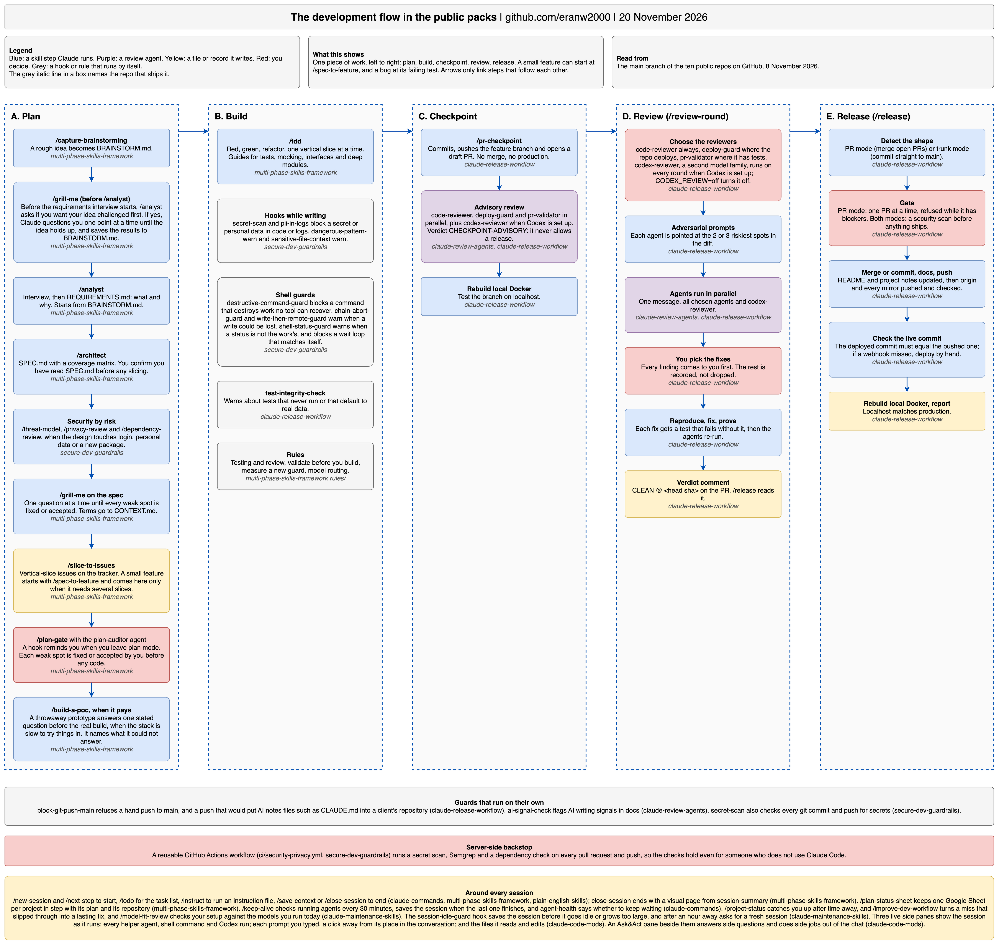
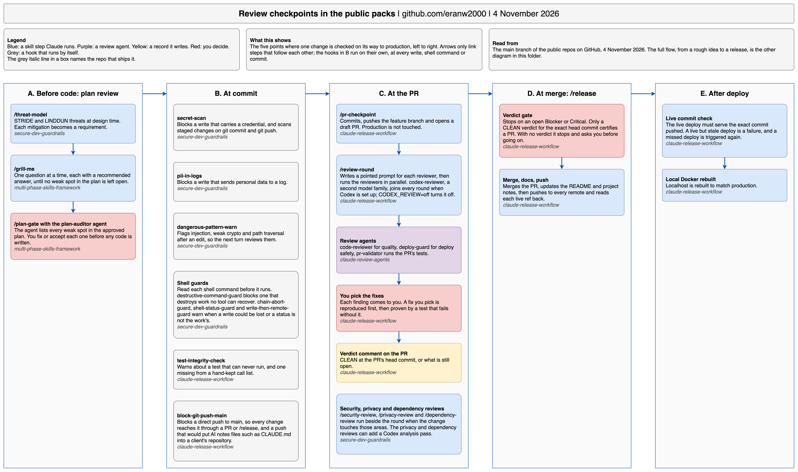
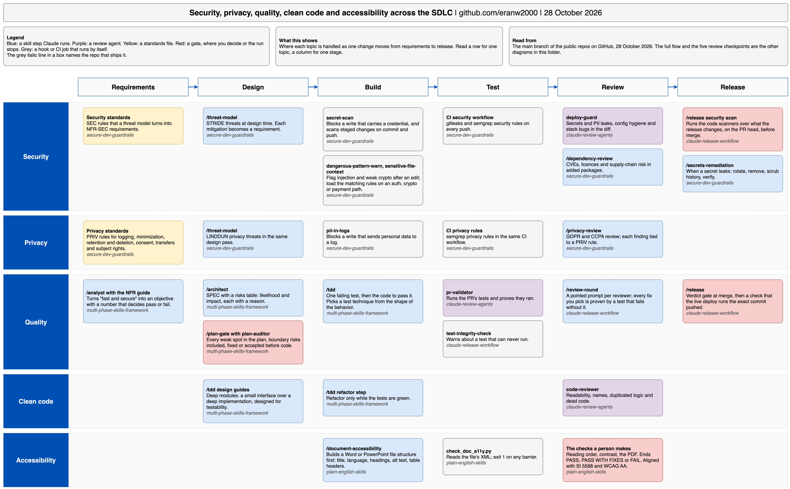
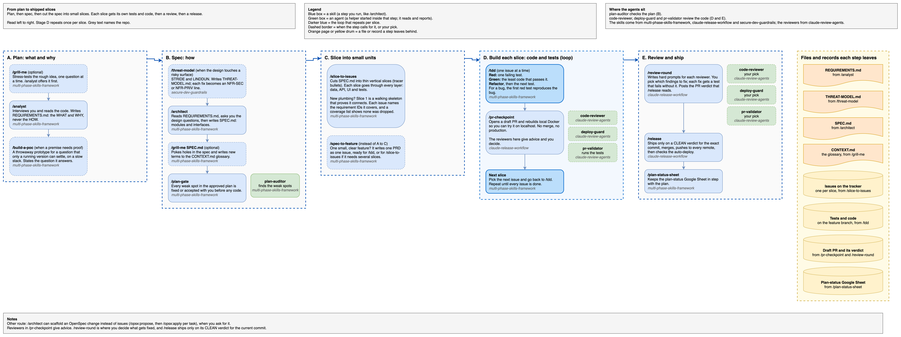

## Hi, I'm Eran 👋

**AI & Data Solutions Architect.** I turn business problems into AI and data systems that run in production, handling the whole path myself: domain research, architecture, development, and live operation.

Since 2024 I have designed, built, and now operate production systems for clients in finance, legal, education, insurance, and consumer health, including:

- A multi-agent financial advisory platform (live public web product)
- A predictive learning-analytics platform, with risk scoring statistically validated against real outcomes
- A B2B account-intelligence pipeline: scraping, enrichment, deduplication, LLM-adjudicated scoring
- A voice + text knowledge-agent framework, deployed as four branded customer instances
- RAG-based legal risk assessment with a secured in-tenant architecture, where no document leaves the client's cloud

Most of that work lives in private repos. What you see here is the **AI-native development infrastructure I build and use daily**: Claude Code workflows for shipping to production, review agents, security and privacy guardrails, multi-phase skill frameworks, and the tooling around them. If you want to know how I work, these repos are the honest sample.

### The public repos

- **[multi-phase-skills-framework](https://github.com/eranw2000/multi-phase-skills-framework)** takes work from a rough idea to tested code through named phases, each leaving a handoff artifact for the next. Includes the plan gate that drives every weak spot in an approved plan to fixed or explicitly accepted before any code is written.
- **[claude-release-workflow](https://github.com/eranw2000/claude-release-workflow)** is the path to production: checkpoint a branch as a PR, run the three-reviewer round, release, then confirm the live deploy runs the commit you pushed. Ships a hook that blocks a direct push to main.
- **[claude-review-agents](https://github.com/eranw2000/claude-review-agents)** reviews a diff before it ships. Four agents covering code quality, deploy safety, whether the PR's tests actually pass, and prose that reads as machine-written, plus a hook that flags such prose in every file Claude writes.
- **[secure-dev-guardrails](https://github.com/eranw2000/secure-dev-guardrails)** handles security and privacy for AI-assisted development: threat modeling, dependency and secret review, plus hooks that block a commit carrying credentials or personal data.
- **[claude-maintenance-skills](https://github.com/eranw2000/claude-maintenance-skills)** keeps project knowledge healthy over time. What state a project is in when you return to it, how to stop its context file from bloating, how to turn a script Claude wrote into a permanent tool of a skill, and whether your setup still fits the models you run today.
- **[claude-commands](https://github.com/eranw2000/claude-commands)** holds the session commands and a status line that shows context use while you work.
- **[drawio-diagram-skill](https://github.com/eranw2000/drawio-diagram-skill)** produces diagrams as draw.io files, then validates and renders them, so the image is looked at before the diagram is called done.
- **[google-slides-skill](https://github.com/eranw2000/google-slides-skill)** rebuilds a Google Slides deck against branding you point it at: one design system, card layouts instead of paragraph dumps, real tables, and a render of every slide it touches before it says the deck is ready.

- **[plain-english-skills](https://github.com/eranw2000/plain-english-skills)** makes Claude write for a reader instead of for the session it has been sitting in: restate the last report in plain English, name the next step with the command to start it, rewrite a document into Simplified Technical English with a checker that exits non-zero on violations, or make a Word or PowerPoint file usable with a screen reader, aligned with SI 5568 and WCAG AA.
- **[claude-code-mods](https://github.com/eranw2000/claude-code-mods)** adds live side panes to Claude Code: one shows every helper agent, shell command and Codex run while it works, one lists each prompt you typed and jumps to it on a click, one shows the files a session reads and edits, one shows your account and how much of each usage limit is used, and one is a box beside the chat that answers side questions and does side jobs.

### How to Install

Each repo's README has its own install steps. The two prompts below do the work for you: paste one into Claude Code as it is.

- **Install** lists the ten repos, asks which ones you want, and follows each one's install steps. It asks before it replaces a file you already have or changes your `settings.json`.
- **Update** is for anyone who installed some of them before. It finds what you have, compares it with the newest version, and updates only the items you pick. It keeps a backup, and it asks before it touches a file you edited.

<details>
<summary><b>Prompt 1: install</b></summary>

```text
I want to install Claude Code packs from github.com/eranw2000 into my own Claude Code setup (~/.claude).

The packs:
- multi-phase-skills-framework
- claude-commands
- claude-review-agents
- claude-maintenance-skills
- claude-release-workflow
- secure-dev-guardrails
- drawio-diagram-skill
- google-slides-skill
- plain-english-skills
- claude-code-mods

Work in this order.

1. Read the README of each pack on its main branch (https://github.com/eranw2000/<pack>). Then show me one short list: each pack, what it gives me in one line, and what it needs on my machine (for example jq, gitleaks, Python 3, Git for Windows). Ask me which packs I want. Wait for my answer.

2. Clone each pack I picked into ~/claude-packs/<pack>. If the folder is already there, run git pull in it. Keep these clones, I will use them for updates.

3. For each pack, follow the "Install" section of its own README, step by step, as written. The README is the source of truth. If a step has an optional part (a hook, a status line, a rules folder, an optional second model), ask me before you install that part.

4. Rules while you install:
   - Before you copy anything, check whether a file or folder with the same name is already in ~/.claude. If it is, show me the difference and ask me before you replace it.
   - Keep each skill folder whole. Copy the folder, not single files from it.
   - Before any change to ~/.claude/settings.json, save a copy as ~/.claude/settings.json.bak-<date>. Merge the new entries into the file. Never replace the file. If a hook entry with the same matcher exists, add the command to its hooks list.
   - Show me the exact settings.json change and wait for my yes before you write it.
   - For claude-code-mods, use the plugin commands from its README.
   - For any step that needs sudo or changes machine-wide settings (secure-dev-guardrails has one), stop and give me the exact command to run myself in a terminal, with one line on what it does.
   - Install only what the READMEs name. Leave everything else in ~/.claude as it is.

5. Check the result: every copied file is in place, every script that the README makes executable is executable, settings.json is still valid JSON, and each README's own check command (where it has one) passes.

6. Write ~/.claude/installed-packs.md. For each pack: the commit I installed (git rev-parse HEAD in the clone), today's date, and the list of files and folders you put in ~/.claude, with the settings.json entries you added.

7. Finish with a short report: what is installed, what I chose to leave out, any command I still have to run myself, and whether I have to restart Claude Code (say what the README says).
```

</details>

<details>
<summary><b>Prompt 2: update what you already installed</b></summary>

```text
I installed some skills, commands, agents, hooks or mods from the github.com/eranw2000 packs a while ago. Update the ones I pick to the newest version. Update only what I already have. Add nothing new unless a thing I have needs it.

The packs: multi-phase-skills-framework, claude-commands, claude-review-agents, claude-maintenance-skills, claude-release-workflow, secure-dev-guardrails, drawio-diagram-skill, google-slides-skill, plain-english-skills, claude-code-mods.

Work in this order.

1. Get the newest version of every pack: git pull in ~/claude-packs/<pack> when the clone is there, or clone https://github.com/eranw2000/<pack> into that folder.

2. Find what I have installed.
   - If ~/.claude/installed-packs.md is there, start from it.
   - Also look in ~/.claude/skills, ~/.claude/skills/_shared, ~/.claude/commands, ~/.claude/agents, ~/.claude/hooks, ~/.claude/rules and ~/.claude/statusline.sh, and match what is there by name against the files in the packs.
   - For the mods, run: claude plugin list

3. For each thing I have, compare it with the newest version in the pack and give it one state:
   - CURRENT: the same as the newest version.
   - OLD: it differs, and it is the same as an earlier version in the pack's git history. Safe to replace.
   - EDITED BY ME: it differs and matches no version in the pack's history. I changed it.
   - RENAMED OR REMOVED: the pack no longer has it under this name. Read the pack's README and git log to find the new name.
   For a skill, compare the whole folder, file by file.

4. Show me one list, grouped by pack, with the state of each item and one line on what changed (read the pack's git log for that item). Then ask me which items to update: all the OLD ones, or the ones I name. Wait for my answer.

5. Update the items I picked.
   - First copy each file or folder you are about to replace into ~/.claude/backups/<date>/, keeping the same path under it.
   - Replace a skill as a whole folder, so new helper files come with it.
   - For an item that is EDITED BY ME, show me my changes next to the new version and ask: keep mine, take the new one, or merge. Never replace it without my answer.
   - For an item that is RENAMED, tell me the old and new name and ask before you install the new one or remove the old one.
   - Read the "Install" section of the pack's README again for the items I picked. If the new version needs a helper file I do not have (for example a shared script or a hook helper), copy it. If the README's settings.json entry for one of my hooks changed, show me the exact change, save ~/.claude/settings.json.bak-<date>, and merge it after my yes. Never replace settings.json.
   - Keep scripts executable where the README says so.
   - For the mods, use the update commands in the claude-code-mods README.
   - For any step that needs sudo (the secure-dev-guardrails machine install), stop and give me the exact command to run myself.

6. Check the result: each updated item is now the same as the pack's newest version, settings.json is still valid JSON, and each README's own check command (where it has one) passes.

7. Update ~/.claude/installed-packs.md with the new commit and date for each item you updated. Create the file if I did not have one.

8. Finish with a short report: what you updated (old commit to new commit), what you left alone and why, where the backups are, any command I still have to run myself, and whether I have to restart Claude Code. At the end, list in one line any new skills, commands, agents or hooks the packs offer that I do not have, for my information only.
```

</details>

### How the repos fit together

Installed together, the repos give one development flow, from a rough idea to a checked release. Each box names the repo that ships it.

[](docs/development-flow.png)

The diagram is a draw.io file, [docs/development-flow.drawio](docs/development-flow.drawio), drawn and rendered with drawio-diagram-skill.

### Where a change gets checked

Every change I ship passes five review checkpoints, from the plan to the live deploy: plan review before any code, hooks at every write and commit, a review round on the PR, a verdict gate at merge, and a check that production runs the exact commit I pushed. Each box names the repo that ships it.

[](docs/review-checkpoints.png)

The diagram is a draw.io file, [docs/review-checkpoints.drawio](docs/review-checkpoints.drawio), drawn and rendered with drawio-diagram-skill.

### Security, privacy and quality at every stage

Where security, privacy, quality, clean code and accessibility are handled as a change moves from requirements to release. Read a row for one topic, or a column for one stage. Each box names the repo that ships it.

[](docs/sdlc-topics.png)

The diagram is a draw.io file, [docs/sdlc-topics.drawio](docs/sdlc-topics.drawio), drawn and rendered with drawio-diagram-skill.

### From plan to small, tested slices

Before I write code, I turn the plan into a spec, then cut the spec into small vertical slices: each slice is a thin path through every layer, from data to UI, with tests, and the first one is the smallest end-to-end version that proves the design. Each slice is then built test first, checked on a draft PR, reviewed and released on its own, so every step stays small enough to check. The diagram shows the order of the steps and, at each one, the skill I run and the agents it starts. Each box names the repo that ships it.

[](docs/plan-to-slices.png)

The diagram is a draw.io file, [docs/plan-to-slices.drawio](docs/plan-to-slices.drawio), drawn and rendered with drawio-diagram-skill.

Before consulting: founder and CEO of InfoGin (acquired by Wix), with products used by more than 100M people; head of product groups at Wix; wrote 15 patents, six granted by the USPTO, in contextual data analysis and adaptive systems (2006-2014), the same class of problems I now solve with modern AI.

### Core technologies

Python · Anthropic Claude · OpenAI GPT · Google Gemini (incl. real-time voice) · LangChain / LangGraph · RAG · Neo4j · Django · FastAPI · Docker · Playwright · Render / AWS / Azure

### Contact

[eranwyler.com](https://www.eranwyler.com) · [LinkedIn](https://www.linkedin.com/in/eranwyler/) · eran@wyler.ai
